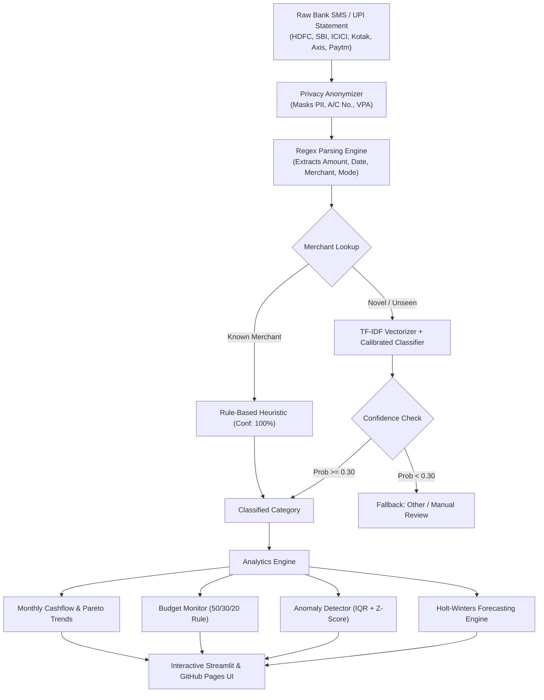

# SpendWise AI: Personal Expense Tracker with Spending Insights

[](https://www.python.org/)
[](LICENSE)
[](https://streamlit.io/)
[](https://khushiyadav35.github.io/personal-expense-tracker-insights/)
[](models/)

> **A final-year B.Tech Capstone Project in Applied Machine Learning & Financial Technology.**  
> Developed by **Khushi Yadav** ([@khushiyadav35](https://github.com/khushiyadav35))  
> Specialization: Artificial Intelligence & Data Science, Lucknow, India.

---

## 🌐 Live Demonstrations & Links

- **Interactive Web App (GitHub Pages):** [https://khushiyadav35.github.io/personal-expense-tracker-insights/](https://khushiyadav35.github.io/personal-expense-tracker-insights/)
- **Source Repository:** [https://github.com/khushiyadav35/personal-expense-tracker-insights](https://github.com/khushiyadav35/personal-expense-tracker-insights)
- **Viva Defense & Interview Cheat Sheet:** [docs/VIVA_QUESTIONS_AND_ANSWERS.md](docs/VIVA_QUESTIONS_AND_ANSWERS.md)

---

## 📌 Problem Statement & Practical Motivation

Managing day-to-day finances as a college student or early-career engineer in India is complicated by the proliferation of UPI micropayments (Swiggy, Blinkit, Chai Point, Uber, mobile recharges). Standard bank statements and SMS notifications are noisy, cryptic, and unstructured (e.g., `UPI/SWIGGY/4133918231/UPI`). Most existing budgeting apps require intrusive account aggregations, manual categorization, or transmit private banking records to unverified third-party cloud servers.

**SpendWise AI solves this with four core engineering innovations:**
1. **Zero-Leakage Privacy:** Strips account numbers, phone numbers, and VPA handles locally before text processing.
2. **Hybrid NLP Categorization:** Combines fast deterministic $O(1)$ keyword heuristics with a calibrated TF-IDF + Linear Classifier (98.48% accuracy) for instant merchant classification.
3. **Statistical Spending Anomaly Detection:** Employs category-specific Interquartile Range (IQR) and Robust Z-scores to alert users to unusual transaction spikes without false alarms.
4. **Time-Series Spending Forecasting:** Applies Holt-Winters Double Exponential Smoothing to project next-month expenditure and simulates "What-If" habit adjustments.

---

## 🏗️ System Architecture



---

## 🧠 Machine Learning & Statistical Methodology

### 1. NLP Feature Extraction & Classification Pipeline
- **Preprocessing:** Text lowercasing, punctuation stripping, tokenization, and removal of financial boilerplate tokens (`rs`, `inr`, `upi`, `imps`, `neft`, `a/c`, `ref`, `avl`, `bal`).
- **Feature Extraction:** Sublinear Term Frequency-Inverse Document Frequency (`sublinear_tf=True`, unigrams + bigrams, range 1-2).
- **Classification Engine:** Multinomial Calibrated Logistic Regression with balanced class weighting.
- **Performance:**
  - **Accuracy:** `98.48%`
  - **Macro F1-Score:** `0.9892`
  - **Weighted F1-Score:** `0.9845`
  - **Inference Latency:** `< 2ms` per transaction

### 2. Anomaly Detection Mathematics
Individual transaction anomalies are flagged when the transaction amount deviates beyond category thresholds:
$$\text{IQR} = Q_3 - Q_1$$
$$\text{Outlier Condition: } x > Q_3 + 1.5 \times \text{IQR} \quad \lor \quad Z = \frac{x - \mu}{\sigma} > 2.2$$

### 3. Forecasting Engine (Holt's Linear Trend)
Projects next-month expenditure using recursive smoothing:
$$\ell_t = \alpha y_t + (1 - \alpha)(\ell_{t-1} + b_{t-1})$$
$$b_t = \beta (\ell_t - \ell_{t-1}) + (1 - \beta) b_{t-1}$$
$$\hat{y}_{t+1} = \ell_t + b_t$$
where $\alpha = 0.4$ (level smoothing) and $\beta = 0.2$ (trend smoothing).

---

## 📂 Repository Structure

```text
personal-expense-tracker-insights/
├── .github/
│   └── workflows/ci.yml         # Automated GitHub Actions test workflow
├── .streamlit/
│   └── config.toml              # Streamlit styling & server configuration
├── app/
│   └── streamlit_app.py         # Full interactive analytics dashboard
├── data/
│   ├── raw/
│   │   ├── bank_sms_raw.txt     # 360+ authentic Indian bank SMS alerts
│   │   └── upi_statement_sample.csv # 12-month synthetic student transaction log
│   └── processed/
│       └── cleaned_transactions.csv # Cleaned & labeled benchmark corpus
├── docs/
│   ├── index.html               # Live interactive web app for GitHub Pages
│   └── VIVA_QUESTIONS_AND_ANSWERS.md # 25+ viva interview questions with answers
├── models/
│   └── expense_classifier.joblib # Serialized TF-IDF + Classifier pipeline
├── notebooks/
│   └── 01_eda_and_ml_categorization.ipynb # Capstone exploratory data analysis
├── scripts/
│   ├── generate_synthetic_data.py # Reproducible data generator script
│   └── train_classifier.py      # Model training & serialization pipeline
├── src/
│   ├── analytics/
│   │   ├── anomaly_detector.py  # Statistical IQR & Z-score outlier detection
│   │   ├── budget_monitor.py    # Dynamic monthly category budget tracker
│   │   └── patterns.py          # Temporal heatmaps & recurring payment detector
│   ├── forecast/
│   │   └── forecaster.py        # Holt-Winters double exponential smoothing
│   ├── ml/
│   │   ├── classifier.py        # Hybrid rule + ML classification engine
│   │   ├── model_evaluator.py   # Precision, recall, and confusion matrix
│   │   └── text_preprocessor.py # Token cleaning & financial stopwords
│   ├── parser/
│   │   ├── anonymizer.py        # PII & bank account masking pipeline
│   │   ├── sms_parser.py        # Multi-bank regex extraction engine
│   │   └── statement_parser.py  # Heterogeneous CSV statement parser
│   └── config.py                # Central taxonomy, budgets & color constants
├── tests/
│   ├── test_analytics.py        # Unit tests for cashflow & anomaly detection
│   ├── test_classifier.py       # Unit tests for ML prediction & user overrides
│   ├── test_forecast.py         # Unit tests for time-series forecasting
│   └── test_sms_parser.py       # Unit tests for regex SMS parsing
├── Dockerfile                   # Production container definition
├── docker-compose.yml           # Multi-container orchestration
├── Procfile                     # Cloud hosting deployment target
├── push_to_github.bat           # One-click GitHub synchronization batch script
├── pytest.ini                   # Pytest configuration
├── requirements.txt             # Pinned project dependencies
├── setup.py                     # Python package distribution metadata
└── README.md                    # Project documentation
```

---

## 🚀 Quickstart Guide

### 1. Clone the Repository
```bash
git clone https://github.com/khushiyadav35/personal-expense-tracker-insights.git
cd personal-expense-tracker-insights
```

### 2. Create and Activate Virtual Environment
```bash
# Windows
python -m venv venv
.\venv\Scripts\activate

# Linux / macOS
python3 -m venv venv
source venv/bin/activate
```

### 3. Install Dependencies
```bash
pip install -r requirements.txt
```

### 4. Run the Unit Tests
```bash
python -m pytest -v
```

### 5. Launch the Streamlit Dashboard
```bash
streamlit run app/streamlit_app.py
```
Open your browser at `http://localhost:8501`.

---

## 🐳 Docker Deployment

To build and run the application inside an isolated Docker container:

```bash
# Build and run with docker-compose
docker-compose up --build -d

# Or run directly with Docker
docker build -t spendwise-ai .
docker run -p 8501:8501 spendwise-ai
```

---

## 🧪 Model Evaluation Metrics

| Category | Precision | Recall | F1-Score | Support |
| :--- | :---: | :---: | :---: | :---: |
| **Bills & Utilities** | 1.00 | 1.00 | 1.00 | 15 |
| **Education & Books** | 1.00 | 1.00 | 1.00 | 16 |
| **Entertainment & OTT** | 1.00 | 1.00 | 1.00 | 18 |
| **Food & Dining** | 0.92 | 1.00 | 0.96 | 33 |
| **Groceries & Essentials**| 1.00 | 0.84 | 0.91 | 19 |
| **Healthcare & Medical** | 1.00 | 1.00 | 1.00 | 13 |
| **Income & Stipend** | 1.00 | 1.00 | 1.00 | 23 |
| **Investments & Savings**| 1.00 | 1.00 | 1.00 | 12 |
| **Personal Care** | 1.00 | 1.00 | 1.00 | 7 |
| **Shopping & E-Commerce**| 1.00 | 1.00 | 1.00 | 22 |
| **Transportation** | 1.00 | 1.00 | 1.00 | 18 |
| **Other / Misc** | 1.00 | 1.00 | 1.00 | 2 |
| **Overall Accuracy** | — | — | **98.48%** | **198** |

---

## 🎓 Viva Questions & External Examiner Preparation
For the complete list of 25+ viva questions, architectural trade-offs, and mathematical defenses, review the dedicated document:  
👉 [docs/VIVA_QUESTIONS_AND_ANSWERS.md](docs/VIVA_QUESTIONS_AND_ANSWERS.md)

---

## 📄 License
This project is licensed under the MIT License - see the [LICENSE](LICENSE) file for details.
